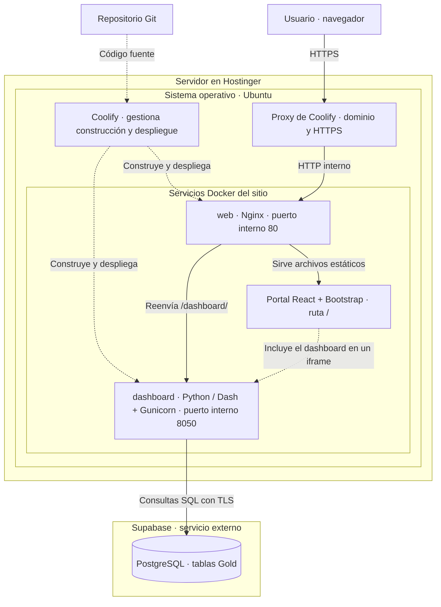
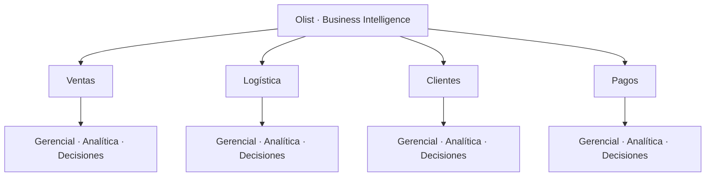

# Arquitectura del sitio Olist

El sitio se aloja en un servidor de **Hostinger** con **Ubuntu**, donde está
instalado **Coolify**. Hostinger y Ubuntu corresponden a la información aportada
por la usuaria. Los servicios, puertos y rutas se tomaron de
`compose.coolify.yaml`, los Dockerfiles y `frontend/nginx.conf`.
Este diagrama describe la configuración del repositorio; no certifica qué
versión del código está desplegada actualmente.

## Infraestructura y flujo de acceso

Las flechas continuas describen el acceso y los datos. Las discontinuas
describen despliegue o integración. La flecha del iframe es una relación lógica:
el navegador solicita `/dashboard/` al mismo dominio, pasando por el proxy y
Nginx. Solo `web:80` recibe el dominio; `dashboard:8050` es interno.

Coolify construye React con Node/Vite y lo publica como archivos estáticos en
Nginx. Node no es un servidor adicional en producción. Dash se ejecuta con
Gunicorn y dos procesos de trabajo. Las credenciales PostgreSQL se inyectan
solo en el servicio `dashboard`. Los datos persistentes están en Supabase;
Compose no crea una base de datos en Hostinger.

## Estructura de navegación

La navegación usa parámetros `area` y `vista`. Ejemplo del portal:
`/?area=pagos&vista=analitica`. El iframe correspondiente utiliza
`/dashboard/?area=pagos&vista=analitica&embed=1`.
Pagos está incluido en el código actual; su disponibilidad en el sitio público
depende de que esa versión haya sido desplegada.

| Capa | Responsabilidad |
| --- | --- |
| Hostinger | Alojar el servidor |
| Ubuntu | Sistema operativo del servidor |
| Coolify | Gestionar construcción, despliegue, dominio y servicios |
| Nginx | Servir el portal y reenviar solicitudes del dashboard |
| React + Bootstrap | Navegación, selección de áreas y vistas, marco visual |
| Dash + Gunicorn | Filtros, cálculos, tablas, gráficos y callbacks |
| Supabase / PostgreSQL | Almacenar y consultar las tablas Gold |

Tablas utilizadas: `gld_sales_detail`, `gld_date_dimension`,
`gld_order_logistics`, `gld_customer_analytics` y `gld_payment_detail`.
